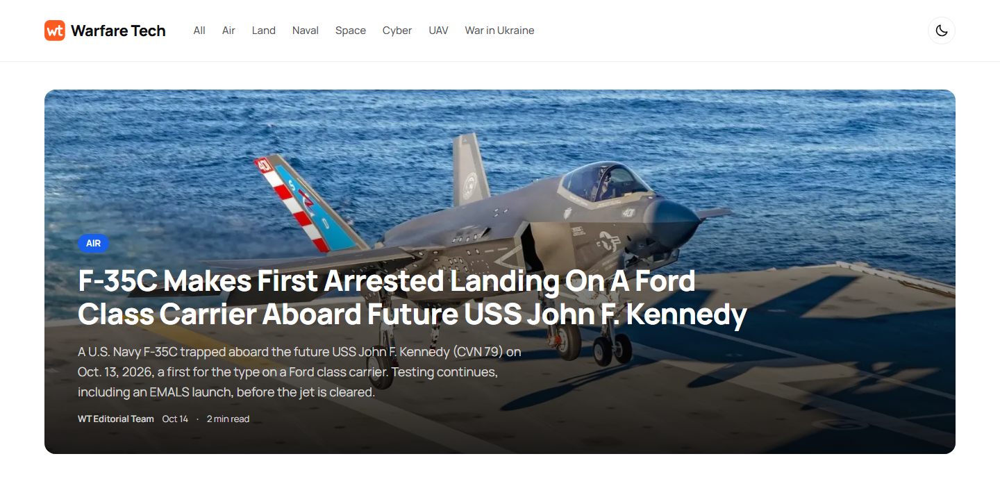
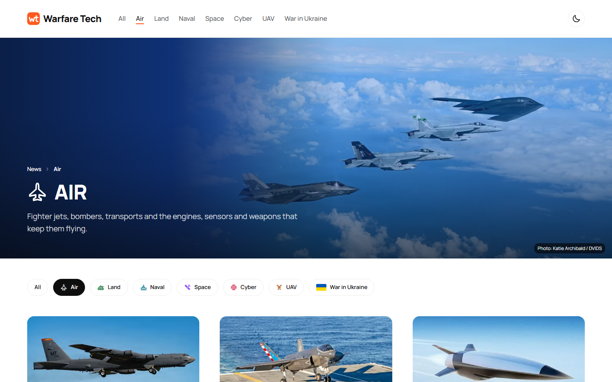

# Warfare Tech

A military technology news site: a Next.js website, a NestJS API and a command-line pipeline that prepares the articles with the Claude API.

**Live site:** https://warfare-tech.com





This is a portfolio project built by one developer, not a newsroom. The articles are rewrites of stories from a fixed list of defense outlets, manufacturers and government agencies. Each one names its source and links to the original, and a person reads every draft before it goes live. The [About page](https://warfare-tech.com/about) describes the process.

## What is in the repository

| Folder | What it is | Stack |
| --- | --- | --- |
| [`client/`](client/) | The website | Next.js 16 (App Router), React 19, TypeScript, SCSS Modules |
| [`server/`](server/) | The REST API | NestJS 11, Prisma 7, PostgreSQL, Zod 4, JWT |
| [`ingestion/`](ingestion/) | The article pipeline (runs locally) | Node, TypeScript, Claude API, Cloudinary |

The three parts are separate npm projects. There is no shared workspace: each has its own `package.json` and is installed and run from its own folder.

## How it works

```
source story ──> ingestion ──> Markdown draft ──> human edit ──> POST /articles
                 (Claude API)                                          │
                                                                       ▼
                    visitor <── Next.js (ISR cache) <── NestJS API <── PostgreSQL
```

### Website (`client/`)

- Server components only fetch data; the API address never reaches the browser.
- Pages are cached with incremental static regeneration. The home page and article pages are served from the cache and rebuilt in the background every five minutes.
- A home page with a featured story and per-section blocks, a paginated news list, seven section pages, article pages, author pages, About and Contact.
- Responsive layout from 320px up, a dark theme that follows the system setting, loading skeletons, and error and not-found pages.
- No UI library: the components, icons and design tokens are written for this project.

### API (`server/`)

- Articles and users, with public read endpoints and an admin-only endpoint for publishing.
- Request validation with Zod schemas. Errors come back in one shape: `{ message, fieldErrors, formErrors }`.
- JWT authentication with role guards. There is no public registration: the single admin account comes from the seed.
- Rate limiting on login and security headers through `helmet`.
- The article body is Markdown restricted to what the website can render: paragraphs, http(s) links and images from allowed hosts. Raw HTML is rejected.

### Ingestion (`ingestion/`)

A command-line tool that turns a source link into a draft:

1. Checks that the link belongs to an allowed source and that the story has not been used before.
2. Fetches the page and extracts the article text.
3. Asks Claude to rewrite it as a short news piece, using only the facts in the source.
4. Measures how much of the draft repeats the wording of the source and highlights those passages.
5. Saves a Markdown draft. The draft is edited by hand in the editor.
6. A separate command validates the edited file against the server rules and publishes it.

Ukrainian-language sources are rewritten in Ukrainian first and then translated.

## Running it locally

You need Node.js 20.9 or newer and a PostgreSQL database.

### 1. API

```bash
cd server
npm install
cp .env.example .env        # then fill in DATABASE_URL, JWT_ACCESS_SECRET and the admin account
npm run prisma:migrate:deploy
npm run prisma:seed         # creates the admin user
npm run start:dev
```

The API listens on `http://localhost:5000/api`. A quick check: `http://localhost:5000/api/articles`.

### 2. Website

```bash
cd client
npm install
cp .env.example .env.local  # API_URL=http://localhost:5000/api
npm run dev
```

The site opens on `http://localhost:3000`. With an empty database it shows empty states.

### 3. Ingestion (optional)

Needed only to create articles. It requires an Anthropic API key and a Cloudinary account.

```bash
cd ingestion
npm install
cp .env.example .env        # API keys, the API address and the admin login

npm start -- <source link>  # creates drafts/<number>.md
npm run pub -- <number>     # publishes the edited draft
```

The other commands (`npm run image`, `npm run translate`, `npm run upload-image`) are the scripts in [`ingestion/package.json`](ingestion/package.json).

## Deployment

| Part | Hosting |
| --- | --- |
| Website | Vercel |
| API | Render |
| Database | Neon (PostgreSQL) |
| Images | Cloudinary |

The `main` branch is deployed; `develop` is the working branch. The API has to be live before the website is built, because the build fetches the home page data.

## Notes for readers of the code

The working notes in this repository ([`BACKLOG.md`](BACKLOG.md), [`DEPLOY.md`](DEPLOY.md)) are written in Ukrainian. The code, the interface and the site content are in English.

## Content and photos

The MIT license below covers the source code only. The article texts are rewrites of third-party reporting, and the reporting belongs to the sources named under each article. Photos are credited on the pages where they appear; the section covers are U.S. military photos from DVIDS. The appearance of U.S. Department of War visual information does not imply or constitute its endorsement.

To report a mistake or to ask for an article or a photo to be changed or removed, open an [issue](https://github.com/panasovskyi/warfare-tech/issues).

## License

[MIT](LICENSE)
